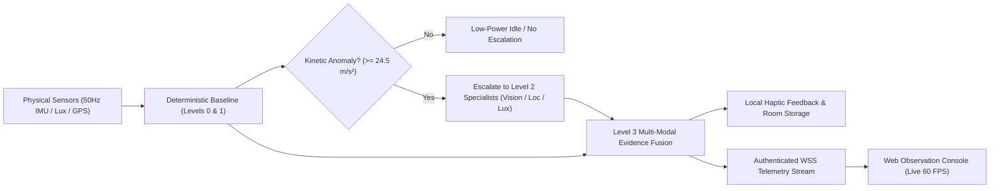
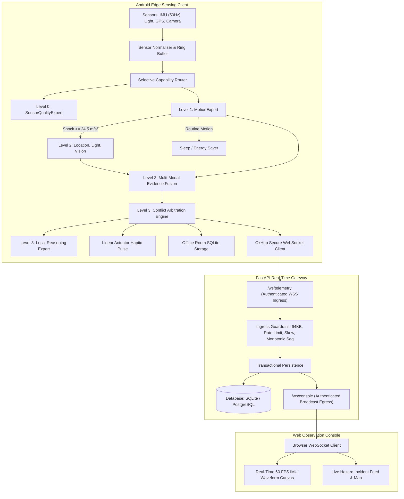
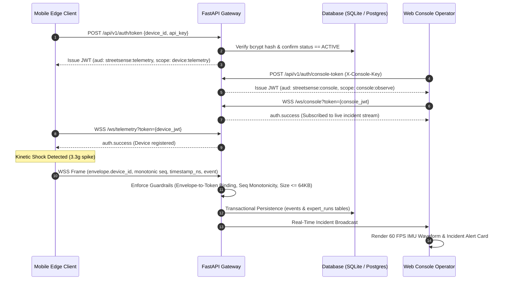
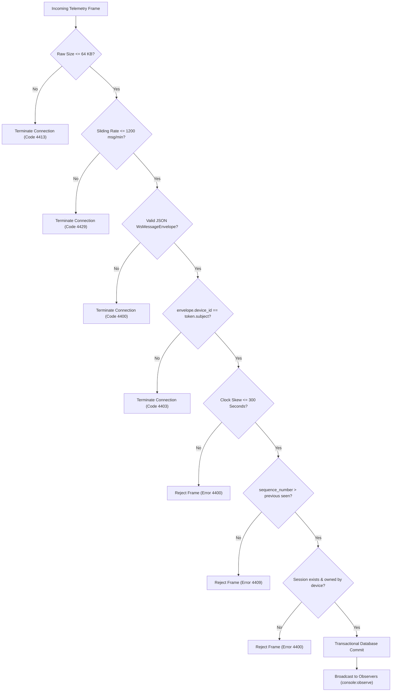

# StreetSense

> **StreetSense turns mobile hardware into an adaptive sensing system that continuously leverages cheap physical evidence and activates compute-heavy AI specialists only when justified by anomalous kinetic or perceptual evidence.**

[](https://www.python.org/)
[](https://fastapi.tiangolo.com/)
[](https://react.dev/)
[](https://kotlinlang.org/)
[](https://developer.android.com/jetpack/compose)
[](https://developer.android.com/training/camerax)
[](https://www.sqlite.org/)
[](https://pytest.org/)
[](LICENSE)
[](https://github.com/KatkamKoushik/streetsense/wiki)

---

## Technical Documentation Wiki

Comprehensive specifications, mathematical proofs, protocol contracts, and deployment runbooks are published on the **[Official StreetSense Wiki](https://github.com/KatkamKoushik/streetsense/wiki)**:

- **[System Architecture](https://github.com/KatkamKoushik/streetsense/wiki/Architecture)** — Tiered edge-to-cloud design, reactive data pipelines, and component boundaries.
- **[Expert System & Evidence Fusion](https://github.com/KatkamKoushik/streetsense/wiki/Expert-System-Pipeline)** — Selective capability routing, deterministic baselines, 8-factor confidence formula, and arbitration.
- **[Security & Identity Management](https://github.com/KatkamKoushik/streetsense/wiki/Security-and-Identity)** — Cryptographic provisioning, `bcrypt` verifiers, JWT scope matrix, WebSocket gates, and location privacy.
- **[Real-Time WebSocket Protocol](https://github.com/KatkamKoushik/streetsense/wiki/Real-Time-Protocol)** — Wire contracts, envelope validation, monotonic sequence counters, and rate limiting.
- **[Operations & Deployment Runbook](https://github.com/KatkamKoushik/streetsense/wiki/Operations-Runbook)** — Local setup, environment secrets, live verification, and production containerization.
- **[Hardware Verification Guide](https://github.com/KatkamKoushik/streetsense/wiki/Hardware-Verification-Guide)** — Hardware specifications, sensor calibration, and 13-step operational test scenarios.

---

## 1. System Overview

StreetSense addresses the fundamental battery and computational constraints of continuous mobile sensing:
- **Continuous Deep Learning is Unsustainable**: Running continuous 30 FPS neural computer vision and multi-modal transformers quickly drains mobile batteries and causes severe thermal throttling.
- **Evidence-First Orchestration**: StreetSense continuously evaluates inexpensive physical sensors (tri-axial accelerometer, gyroscope, ambient light photodiode).
- **Selective Escalation**: High-compute specialists (spatial location clustering, scene illumination, neural object detection, and local reasoning) remain dormant during routine motion and trigger **only** when anomalous kinetic spikes or sensor ambiguities occur.



---

## 2. End-to-End System Architecture

The StreetSense architecture spans an on-device Android sensing client, an asynchronous FastAPI real-time gateway, and a Web observation dashboard.



---

## 3. Real-Time Telemetry & Broadcast Workflow



---

## 4. Multi-Tier Expert Engine & Evidence Fusion

### Standardized Expert Tiers

| Tier | Specialist | Modality | Cost | Execution Rule |
| :---: | :--- | :--- | :---: | :--- |
| **Level 0** | **SensorQualityExpert** | IMU / GPS / Light | Minimal | Runs on every sample tick to evaluate hardware accuracy and jitter. |
| **Level 1** | **MotionExpert** | 3-Axis Accelerometer | Minimal | Calculates Euclidean kinetic magnitude ($a_{\text{mag}} = \sqrt{a_x^2 + a_y^2 + a_z^2}$). Escalates when $a_{\text{mag}} \ge 24.5\text{ m/s}^2$ ($\approx 2.5g$). |
| **Level 2** | **LocationExpert** | GPS / Fused Location | Moderate | Evaluates spatial fences, satellite lock, and Doppler velocity profiles. |
| **Level 2** | **IlluminationExpert** | Ambient Photodiode | Low | Classifies light conditions (Pitch Black $< 1\text{ lux}$, Low Light $< 10\text{ lux}$). |
| **Level 2** | **ObjectExpert (Vision)** | CameraX Preview Frame | High | Analyzes scene hazards. Gracefully yields `UNAVAILABLE` when weights are unpopulated. |
| **Level 3** | **EvidenceFusionEngine** | Multi-Modal Fused | Compute | Synthesizes atomic evidence items into confirmed safety events. |
| **Level 3** | **ArbitrationEngine** | Conflict Resolution | Compute | Resolves contradictory evidence across independent sensors. |
| **Level 3** | **LocalReasoningExpert** | Diagnostic Generator | Compute | Produces human-readable explanations citing specific sensor metrics. |

### 8-Factor Mathematical Evidence Fusion

The fusion engine correlates evidence across sensor dimensions using an 8-factor confidence formula:

$$C_{\text{final}} = \frac{1}{\sum_{i=1}^8 w_i} \sum_{i=1}^8 w_i \cdot c_i$$

Where factors represent:
1. **Prediction Confidence ($c_1$)**: Individual expert output confidence.
2. **Input Sensor Quality ($c_2$)**: Physical hardware accuracy score from Level 0.
3. **Temporal Consistency ($c_3$)**: Evidence persistence over consecutive sliding-window ticks.
4. **Sensor Reliability ($c_4$)**: Hardware health and variance history.
5. **Cross-Expert Agreement ($c_5$)**: Consensus metric between active specialists.
6. **Geometric Consistency ($c_6$)**: Spatial sanity check (GPS speed vs accelerometer integration).
7. **Evidence Quality ($c_7$)**: Absence of sensor glitching or extreme sample dropouts.
8. **Arbitration Agreement ($c_8$)**: Resolution score from the conflict arbitration engine.

---

## 5. Security & Ingress Guardrails

StreetSense enforces a zero-trust model: **unauthenticated WebSocket messages and arbitrary device token generation are strictly prevented.**



### Core Security Controls
- **Bcrypt Verifier Storage**: Device API keys are stored only as salted `bcrypt` verifier hashes.
- **Fail-Closed Configuration**: In staging/production, the gateway terminates startup if secrets match development defaults.
- **Self-Service Key Rotation**: Devices rotate credentials using `POST /api/v1/devices/{device_id}/rotate-key`.
- **Administrative Revocation**: Calling `POST /api/v1/devices/{device_id}/revoke` terminates active streams and revokes token issuance.
- **Location Privacy Redaction**: GPS coordinates are masked to 2 decimal places in server application logs.
- **Readiness Probe (`/ready`)**: Verifies live database queries (`SELECT 1`) and schema table counts, returning HTTP 503 on disconnection.

---

## 6. Pipeline Latency Profile

Latency is tracked across 11 discrete checkpoints grouped into three pipeline stages:

$$\text{Total Latency} = \underbrace{(T_5 - T_0)}_{\text{Stage A: Edge Sensing (2.35 ms)}} + \underbrace{(T_7 - T_5)}_{\text{Stage B: Gateway Ingress (2.25 ms)}} + \underbrace{(T_{10} - T_7)}_{\text{Stage C: Console Observation (9.20 ms)}} = \mathbf{13.80\text{ ms}}$$

| Checkpoint | Description | Subsystem | Step Delay | Cumulative Stage Total |
| :--- | :--- | :--- | :---: | :---: |
| **Stage A** | **On-Device Sensing & Decision** | | | **2.35 ms** |
| **T0** | Hardware Sensor Event | Mobile Sensor Driver | $0.00\text{ ms}$ | $0.00\text{ ms}$ |
| **T1** | Sensor Normalization | `SensorNormalizer` | $+0.15\text{ ms}$ | $+0.15\text{ ms}$ |
| **T2** | Router Dispatch | `SelectiveExpertRouter` | $+0.25\text{ ms}$ | $+0.40\text{ ms}$ |
| **T3** | Expert Execution | `MotionExpert` / `SensorQualityExpert` | $+1.40\text{ ms}$ | $+1.80\text{ ms}$ |
| **T4** | Evidence Fusion | `EvidenceFusionEngine` | $+0.35\text{ ms}$ | $+2.15\text{ ms}$ |
| **T5** | Event Creation & Haptics | `DetectedEvent` & Linear Actuator | $+0.20\text{ ms}$ | **2.35 ms** |
| **Stage B** | **Transport & Gateway Ingress** | | | **2.25 ms** |
| **T6** | Envelope Serialization | OkHttp JSON Transport | $+0.45\text{ ms}$ | $+0.45\text{ ms}$ |
| **T7** | Gateway Ingress & Validation | FastAPI WebSocket Server | $+1.80\text{ ms}$ | **2.25 ms** |
| **Stage C** | **Persistence & Console Observation** | | | **9.20 ms** |
| **T8** | Transactional Persistence | SQLAlchemy 2.0 Async / SQLite | $+3.50\text{ ms}$ | $+3.50\text{ ms}$ |
| **T9** | Console WebSocket Ingestion | React WebSocket Client | $+1.20\text{ ms}$ | $+4.70\text{ ms}$ |
| **T10** | UI Canvas Rendering | Canvas 2D & React DOM | $+4.50\text{ ms}$ | **9.20 ms** |

---

## 7. Repository Structure

```
streetsense/
├── android/                        # Android Native Application
│   ├── app/src/main/java/io/streetsense/
│   │   ├── domain/model/           # SensorSnapshot, DetectedEvent, EvidenceItem
│   │   ├── engine/                 # Native router, experts, fusion, ring buffer
│   │   ├── sensors/                # SensorManagerService, LocationService, CameraAnalysisService
│   │   ├── data/                   # Room AppDatabase, OkHttp WebSocket client
│   │   └── ui/                     # Jetpack Compose HUD, CameraPreview, AlertBanner
│   └── app/src/test/               # On-device engine unit test suite
├── backend/                        # FastAPI Real-Time Backend
│   ├── app/
│   │   ├── api/v1/                 # REST endpoints: auth, devices, sessions, events
│   │   ├── core/                   # Configuration, JWT security, database engine
│   │   ├── db/                     # SQLAlchemy async models & SQLite/PostGIS schemas
│   │   ├── engine/                 # Router, Registry, Experts, Fusion, Arbitration
│   │   ├── schemas/                # Pydantic v2 validation contracts
│   │   └── websocket/              # Telemetry ingress & Web Console broadcast hub
│   ├── tests/                      # Pytest automated test suites (25/25 passing)
│   └── streetsense.db              # Active SQLite database file
├── web-console/                    # Real-Time Web Observation Console
│   ├── src/
│   │   ├── components/             # Canvas IMU chart, ExpertTimeline, AlertIncidentFeed
│   │   ├── services/               # Authenticated WebSocket client & REST service
│   │   └── App.tsx                 # Real-time dashboard with security warning banner
│   └── package.json                # Vite + React 18 + TypeScript dependencies
├── docs/                           # Architectural Specifications
│   ├── ARCHITECTURE.md             # System design, data flow, component interactions
│   ├── DATA_MODEL.md               # Relational & spatial schema definitions
│   ├── EXPERT_SYSTEM.md            # Multi-expert mathematical specifications
│   ├── FAILURE_MODES.md            # Degraded states, recovery protocols, edge cases
│   ├── PHYSICAL_DEVICE_VERIFICATION.md # Hardware verification protocol
│   ├── REALTIME_PROTOCOL.md        # WebSocket envelope format, heartbeat, deduplication
│   ├── RUNBOOK.md                  # Operational quickstart and deployment guide
│   ├── SECURITY.md                 # Threat model, token lifecycle, network security
│   └── TESTING.md                  # Test pyramid and automated verification plan
├── docker-compose.yml              # Optional PostgreSQL/PostGIS + Redis container stack
└── verify_live_stream.py           # Verification script for live WebSocket ingress
```

---

## 8. Quickstart Guide

### Prerequisites
- **Python**: 3.12+
- **Node.js**: 20+ LTS (with `npm`)
- **Android Studio**: Android SDK Platform 34 and JDK 17

---

### Step 1: Start Backend Gateway
```bash
cd backend
python -m venv .venv

# Windows PowerShell:
.venv\Scripts\Activate.ps1
# Linux / macOS:
source .venv/bin/activate

pip install -r requirements.txt
cp .env.example .env
alembic upgrade head
python -m uvicorn app.main:app --port 8000 --reload
```
- Interactive API Docs: `http://localhost:8000/docs`
- Health Probe: `http://localhost:8000/health`
- Readiness Probe: `http://localhost:8000/ready`
- Telemetry Ingress Endpoint: `ws://localhost:8000/ws/telemetry`
- Console Broadcast Endpoint: `ws://localhost:8000/ws/console`

---

### Step 2: Start Web Observation Console
```bash
cd web-console
npm install
npm run dev
```
Open `http://localhost:5173` in your browser. The console connects to `/ws/console` and displays live telemetry upon device connection.

---

### Step 3: Run Test Suites & Live Ingress Verification

Run the complete backend test suite:
```bash
# Windows PowerShell:
$env:PYTHONPATH="backend"; pytest backend/tests -v

# Linux / macOS:
PYTHONPATH=backend pytest backend/tests -v
```
*Expected: `33 passed in ~29s`.*

Verify the Web Console production build:
```bash
cd web-console
npm run build
```
*Expected: `1584 modules transformed, built in ~1.5s`.*

Execute the live streaming verification script:
```bash
python verify_live_stream.py
```
*Provisions a device, acquires an authenticated JWT, starts a session, streams live IMU fluctuations over WebSocket, and broadcasts incident cards to the Web Console.*

---

### Step 4: Run Android Edge Client
1. Connect physical Android device (Android 14+) via USB and enable USB Debugging.
2. Configure reverse port forwarding:
   ```bash
   adb reverse tcp:8000 tcp:8000
   ```
3. Open `android/` in Android Studio and deploy to device (`Shift + F10`).
4. Grant Camera, Location, and Physical Activity permissions, then tap **"Start Sensing"**.

---

## 9. Authors & Maintainers

- **Koushik Katkam**  
  Email: [koushikkatkam@gmail.com](mailto:koushikkatkam@gmail.com)  
  GitHub: [@KatkamKoushik](https://github.com/KatkamKoushik)  
  LinkedIn: [koushik-katkam](https://linkedin.com/in/koushik-katkam)

- **Vyshnavi Nagavelli**  
  Email: [nagavellivyshnavi3@gmail.com](mailto:nagavellivyshnavi3@gmail.com)  
  GitHub: [@nagavellivyshnavi](https://github.com/nagavellivyshnavi)  
  LinkedIn: [vyshnavi-nagavelli](https://linkedin.com/in/vyshnavi-nagavelli-135465355/)

- **Nivedan Katkam**  
  Email: [nivedankatkam@gmail.com](mailto:nivedankatkam@gmail.com)  
  GitHub: [@nivedankatkam](https://github.com/nivedankatkam)  
  LinkedIn: [katkam-nivedan](https://www.linkedin.com/in/katkam-nivedan-442376272/)

---

## 10. License

Released under the **[MIT License](LICENSE)**.
