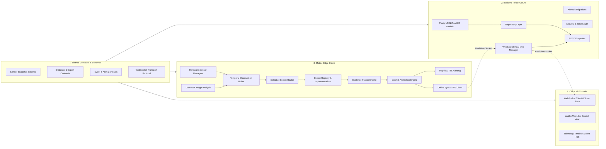
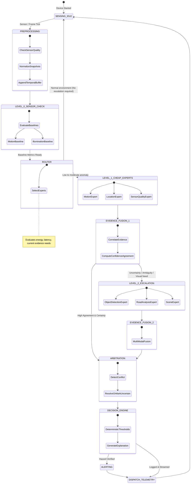
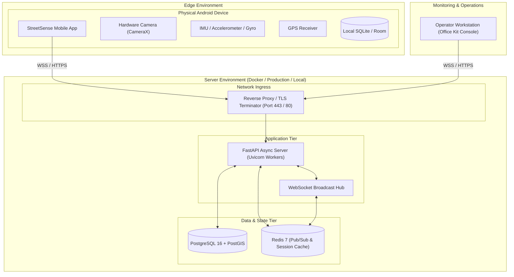

# StreetSense — System Architecture

## 1. Executive Summary & Vision

StreetSense is a real-time mobile environmental and activity sensing platform featuring a **Selective Multi-Expert Architecture**. Rather than executing a monolithic, energy-draining deep learning pipeline on every camera frame and sensor tick, StreetSense employs an evidence-first, capability-driven router that executes lightweight, deterministic specialists first, progressively escalating to multi-modal fusion, expensive edge models, and local reasoning only when environmental evidence justifies it.

The platform spans three primary tiers:
1. **Real-time Mobile Client (Android / Kotlin / Jetpack Compose / CameraX / Sensor APIs)**:
   - Lifecycle-safe sensor streams (Accelerometer, Gyroscope, Magnetometer, Ambient Light, Fused Location).
   - CameraX frame capture with adaptive sampling, frame quality checks, and backpressure management.
   - Sensor normalization engine producing timestamped, high-precision snapshots.
   - Local temporal ring-buffer for multi-frame and temporal persistence analysis.
   - On-device selective expert routing and execution.
   - Evidence fusion, conflict arbitration, escalation engine, and deterministic decision engine.
   - Real-time local alerting (haptic feedback, audio/voice cues, visual HUD).
   - Offline-first SQLite persistence and reliable background sync queue.
2. **Real-time Backend Gateway & Processing Engine (FastAPI / WebSockets / PostgreSQL + PostGIS / Redis)**:
   - Device and session registration, cryptographic authentication (JWT / API tokens).
   - Bi-directional WebSocket real-time transport with heartbeat, backpressure, and reconnection recovery.
   - Ingestion and persistence of normalized sensor snapshots, expert execution telemetry, evidence traces, and hazard events.
   - PostGIS spatial indexing for geospatial queries and proximity fences.
   - Event pub/sub bus broadcasting live telemetry to connected observation clients.
3. **Office Kit Observation Console (Vite / React / TypeScript / Modern High-Performance UI)**:
   - Live stream visualization of connected devices, active sessions, and hardware telemetry.
   - Real-time timeline of expert activations, inference latencies, confidence metrics, and evidence graphs.
   - Interactive spatial map displaying device trajectory and localized hazard detections.
   - Alert management console with audio notifications and operator acknowledgement controls.
   - Zero mock data: true real-time streaming state with explicit empty/disconnected/degraded indicators.

---

## 2. High-Level System Architecture Diagram

```mermaid
graph TD
    subgraph MobileDevice ["Android Mobile Device (StreetSense Edge Client)"]
        subgraph HardwareSensors ["Hardware Sensing Layer"]
            CAM[CameraX Preview/Analysis]
            IMU[Accelerometer & Gyroscope]
            MAG[Magnetometer / Compass]
            LIGHT[Ambient Light Sensor]
            GPS[Fused Location Provider]
        end

        subgraph Preprocessing ["Sensing & Temporal Layer"]
            SQ[Sensor Quality & Normalizer]
            TB[Temporal Ring Buffer (History)]
        end

        subgraph Orchestration ["Selective Multi-Expert Engine"]
            ER[Expert Registry]
            SR[Selective Expert Router]
            EX_CHEAP[Level 1: Motion, Location, SensorQuality Experts]
            EX_VISION[Level 2: Vision, Road, Scene Experts]
            FUSION[Evidence Fusion Engine]
            ARB[Conflict Arbitration Engine]
            ESC[Escalation Engine]
            DEC[Deterministic Decision Layer]
            REASON[Local Reasoning & Explanation]
        end

        subgraph EdgeAction ["Local Action & Persistence"]
            ALERT[Local Alert Engine: Haptic / Voice / HUD]
            ROOM[Local Event & Sync Queue (SQLite/Room)]
        end
    end

    subgraph BackendInfrastructure ["StreetSense Backend Platform"]
        WS_GW[Real-time WebSocket Gateway]
        REST_API[FastAPI REST API Engine]
        AUTH[Auth & Device Registry]
        EVENT_BUS[Pub/Sub Real-time Event Bus]
        DB[(PostgreSQL + PostGIS)]
        CACHE[(Redis State & Pub/Sub)]
    end

    subgraph OfficeKitConsole ["Office Kit Observation Console (Web / Operator)"]
        DASH[Live Device & Session Monitor]
        HUD[Telemetry & Sensor HUD]
        EVD_GRAPH[Evidence & Expert Timeline]
        MAP[PostGIS Spatial Hazard Map]
        ALERT_MON[Incident & Alert Management]
    end

    %% Mobile Data Flow
    HardwareSensors --> SQ
    SQ --> TB
    TB --> SR
    SR -->|Capability Routing| ER
    ER --> EX_CHEAP
    EX_CHEAP -->|Evidence Generated| FUSION
    FUSION -->|Uncertainty / Threshold Trigger| ESC
    ESC -->|Escalate| EX_VISION
    EX_VISION --> FUSION
    FUSION --> ARB
    ARB --> DEC
    DEC --> REASON
    DEC --> ALERT
    DEC --> ROOM
    ROOM -->|Authenticated Sync / Live Stream| WS_GW

    %% Backend Flow
    WS_GW <--> REST_API
    REST_API --> AUTH
    REST_API --> EVENT_BUS
    REST_API --> DB
    EVENT_BUS <--> CACHE

    %% Office Kit Flow
    EVENT_BUS -->|Live Event Stream| OfficeKitConsole
    REST_API -->|Historical & Session Queries| OfficeKitConsole
```

---

## 3. Component Dependency Graph



---

## 4. Selective Multi-Expert Routing & Escalation Model



---

## 5. Deployment Topology


