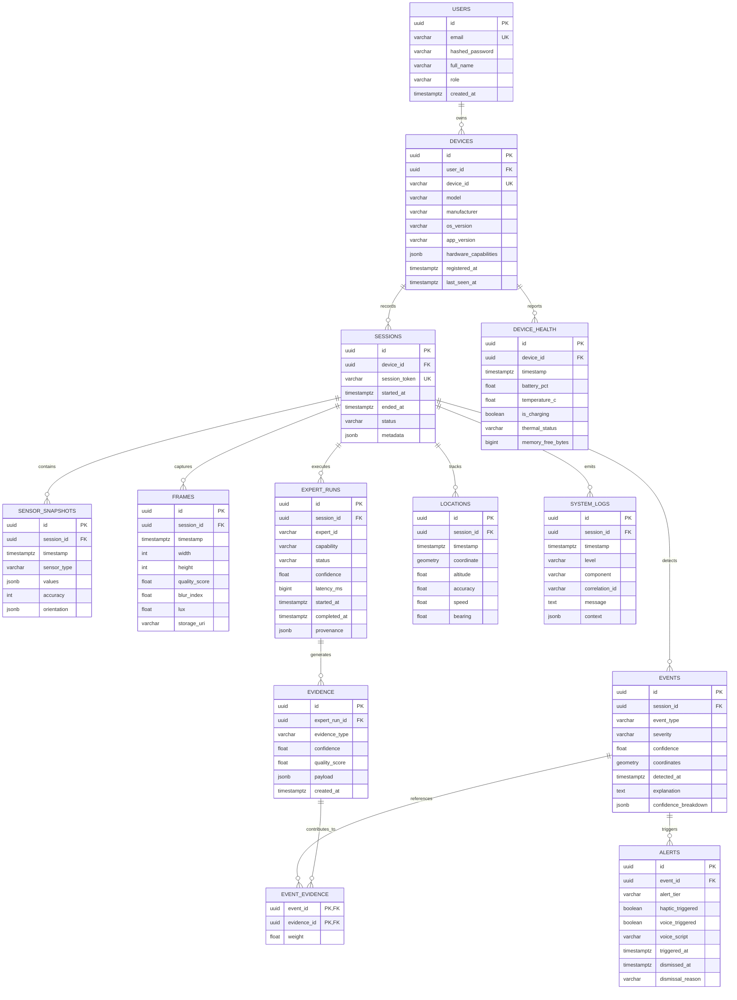

# StreetSense — Data Model & Storage Specification

## 1. Relational Database Schema (PostgreSQL + PostGIS)

The backend data model models all entities involved in mobile environmental sensing, expert execution telemetry, evidence traces, and hazard lifecycle.



---

## 2. Table Specifications & PostGIS Columns

### `locations` & `events` PostGIS Integration
Geospatial fields use standard WGS84 coordinates (`SRID=4326`):
- `locations.coordinate`: `GEOMETRY(Point, 4326)`
- `events.coordinates`: `GEOMETRY(Point, 4326)`

Spatial Indexing:
```sql
CREATE INDEX idx_locations_geom ON locations USING GIST(coordinate);
CREATE INDEX idx_events_geom ON events USING GIST(coordinates);
CREATE INDEX idx_events_detected_at ON events(detected_at DESC);
CREATE INDEX idx_sensor_snapshots_session_time ON sensor_snapshots(session_id, timestamp DESC);
CREATE INDEX idx_expert_runs_session ON expert_runs(session_id, completed_at DESC);
```

---

## 3. Data Retention & Pruning Policies

To prevent unchecked disk growth and maintain high query performance:
1. **Raw Frames**: Never store raw uncompressed frames on disk indefinitely. High-resolution frames are analyzed in-memory at the edge. Selected keyframes with verified hazard evidence are stored compressed with a **7-day retention policy**.
2. **High-Frequency Sensor Snapshots (50 Hz IMU)**: Aggregated into 1-second statistical summaries (min, max, mean, variance) after **48 hours**. Raw high-frequency ticks older than 48 hours are automatically pruned.
3. **Events, Evidence, and Alerts**: Maintained permanently for auditability, incident reconstruction, and model evaluation.

---

## 4. Mobile Edge SQLite / Room Database Schema

On the Android client, an offline-first SQLite database preserves operational state during connectivity blackouts:

- `local_sessions`: Current active session ID, start time, device sync status.
- `local_events`: Persists generated events before sync confirmation:
  - `event_id` (UUID PK), `timestamp`, `event_type`, `severity`, `confidence`, `payload_json`, `synced_to_backend` (Boolean), `retry_count` (Int).
- `local_evidence`: Cache of recent evidence items for temporal window calculations.
- `local_sensor_buffer`: Sliding window of sensor snapshots used by `TemporalChangeExpert` and `MotionExpert`.
- `sync_queue`: Ordered FIFO queue of outgoing messages with exponential backoff metadata.
