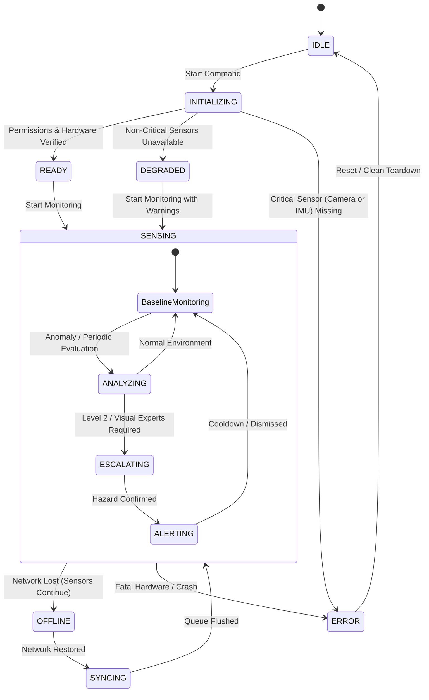

# StreetSense — Failure Modes & State Machine Specification

## 1. Zero-Fake-Fallback Policy

A foundational tenet of StreetSense is that **no subsystem may ever mask a failure with fabricated data or synthetic success**.
- If GPS signal is lost, the system reports `GPS_UNAVAILABLE` with accuracy `null`; it never emits synthetic coordinates or cached stale points disguised as live.
- If a machine learning model is missing or fails to execute, the expert marks status `UNAVAILABLE` or `FAILED`; it never returns a dummy detection array or random confidence.
- If network connectivity is lost, the system transitions to `OFFLINE`; it queues events locally and surfaces offline telemetry in the UI rather than pretending sync succeeded.

---

## 2. System Lifecycle State Machine



### System States Table
| State | Description | Permitted Actions |
| :--- | :--- | :--- |
| `IDLE` | App launched, background services inactive | Configure settings, inspect permissions |
| `INITIALIZING` | Probing hardware sensors, loading models | Query availability, allocate buffers |
| `READY` | All required sensors and models healthy | Start continuous session |
| `SENSING` | Real-time streams active, Level 0-1 baseline checks running | Continuous monitoring |
| `ANALYZING` | Evidence evaluation underway | Routing, fusion, kinetic checks |
| `ESCALATING` | High-tier specialists running on-demand | Visual inference, spatial context |
| `ALERTING` | Hazard confirmed; active haptic/voice/HUD feedback | User dismissal, cooldown suppression |
| `DEGRADED` | Operating with reduced capabilities (e.g. GPS absent or Low Light) | Fallback to kinetic/optical only, alert user of reduced fidelity |
| `OFFLINE` | No network connection to backend | Edge alerting remains 100% active; queue events to local SQLite |
| `SYNCING` | Network re-established; flushing queued events | Background transmission with backoff |
| `ERROR` | Unrecoverable failure in core sensor pipeline | Graceful shutdown, diagnostic reporting |

---

## 3. Expert Execution State Machine

Each expert declares an explicit runtime state during every execution pass:

```
AVAILABLE -> SELECTED -> RUNNING -> [ SUCCESS | FAILED | TIMEOUT | SKIPPED | UNAVAILABLE ]
```

- `AVAILABLE`: Expert model is initialized and hardware inputs are functioning.
- `SELECTED`: Router has scheduled this expert for the current evidence pass.
- `RUNNING`: Execution currently progressing in thread pool / neural accelerator.
- `SUCCESS`: Execution completed within latency budget; evidence generated.
- `FAILED`: Execution threw an exception; logged with stack trace and correlation ID.
- `TIMEOUT`: Execution exceeded latency deadline (e.g. > 100ms on frame analysis); killed to prevent frame pipeline backpressure.
- `SKIPPED`: Router determined capability was unnecessary based on Level 0/1 evidence.
- `UNAVAILABLE`: Model file absent, platform runtime incompatible, or required hardware sensor unmounted.

---

## 4. Hardware Failure Matrix & Mitigation

| Failure | Detection Mechanism | Immediate Edge Action | System State Transition |
| :--- | :--- | :--- | :--- |
| **Camera Unavailable / Locked** | CameraX `InitializationException` or `CameraAccessException` | Disable vision experts (`ObjectExpert`, `RoadExpert`); continue kinetic alerting | `DEGRADED` |
| **GPS Unavailable / No Lock** | `LocationCallback` timeout > 10s or provider disabled | Disable `SpatialContextExpert`; rely on visual and IMU velocity estimation | `DEGRADED` |
| **IMU Disconnected** | `SensorEventListener` onAccuracyChanged or zero events for 1s | Critical: cannot estimate user motion or orientation | `ERROR` |
| **Ambient Light Sensor Missing** | `SensorManager.getDefaultSensor(TYPE_LIGHT)` returns `null` | Approximate illumination from CameraX `ImageProxy` average luma | `READY` (Soft fallback) |
| **Thermal Throttling (Severe)** | Android `PowerManager.OnThermalStatusChangedListener` (STATUS_SEVERE / CRITICAL) | Throttle visual inference rate (e.g. 1 Hz max); drop expensive segmentation | `DEGRADED` |
| **Battery Low (< 15%)** | `ACTION_BATTERY_LOW` broadcast received | Elevate escalation thresholds; restrict vision runs to verified kinetic shocks | `DEGRADED` |
| **Backend Unreachable** | WebSocket connection timeout / handshake HTTP 50x | Direct all event emission to local SQLite buffer; display offline badge on HUD | `OFFLINE` |
