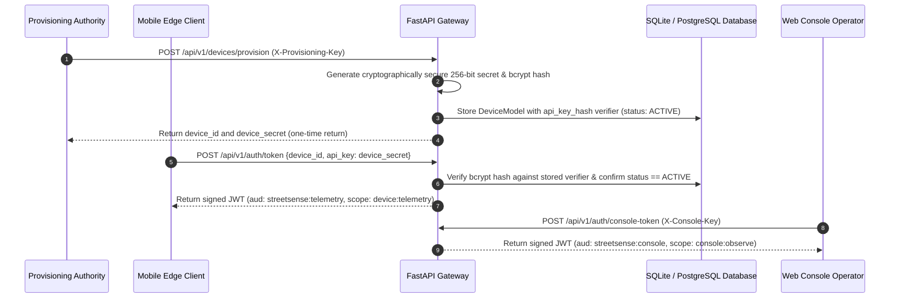
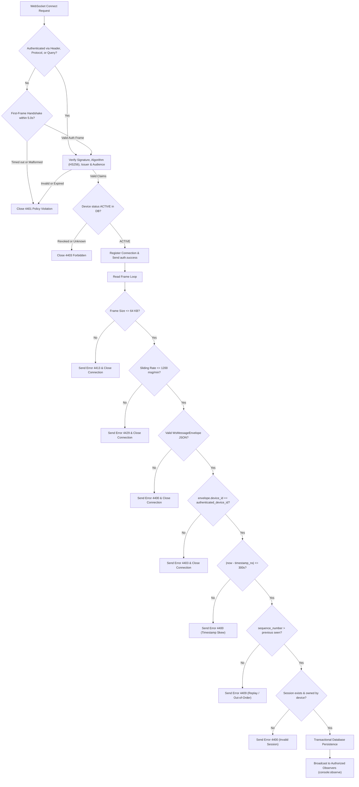

# StreetSense Security & Privacy Architecture

## 1. Threat Model & Security Posture

StreetSense ingests and processes sensitive high-frequency telemetry from mobile devices, including real-time GNSS location data, accelerometer/gyroscope kinematics, light readings, and local camera-derived hazard events. The security architecture addresses the following threat vectors:

1. **Unauthorized Device Impersonation & Spoofing**: Attackers attempting to register arbitrary devices, forge safety incidents, or fabricate telemetry without provisioned credentials.
2. **WebSocket Ingress Eavesdropping & Injection**: Unauthenticated access to WebSocket streams, token leakage in logs/URLs, and injection of out-of-order or oversized payloads.
3. **Observer Telemetry Interception**: Unauthorized parties listening to sensitive live pedestrian safety alerts or fine-grained location tracking.
4. **Data Tampering & Replay Attacks**: Tampering with sequence numbers or replaying old sensor ticks to generate artificial alerts.
5. **Denial of Service**: Flooding WebSocket channels with high-frequency frames (>20 Hz) or oversized envelopes (>64 KB).
6. **Location Privacy Leakage**: Storage and logging of raw high-precision GPS coordinates exposing pedestrian transit patterns.

---

## 2. Cryptographic Identity & Per-Device Provisioning

StreetSense enforces a zero-trust model: **no telemetry frame is ever accepted from an unauthenticated client, and arbitrary token generation is forbidden.**



### 2.1 Cryptographic Verifier Storage
- Device secrets are never stored in plaintext or reversible encryption.
- Stored secrets use `bcrypt` salted password hashing with adaptive cost factor.
- Database compromises only expose cryptographic verifiers, preventing mass token issuance.

### 2.2 Key Rotation & Immediate Revocation
- **Rotation (`POST /api/v1/devices/{device_id}/rotate-key`)**: Devices can rotate their secret key by proving possession of the current secret. Upon successful rotation, the rotation counter is incremented, and subsequent requests must use the new key.
- **Revocation (`POST /api/v1/devices/{device_id}/revoke`)**: Provisioning administrators can immediately revoke a compromised device. Revocation flags `status = "REVOKED"` and sets `revoked_at`. All future token requests and active WebSocket connections for the device are terminated with `403 Forbidden` / `4403 Policy Violation`.

### 2.3 Strict Production Fail-Closed Policy
In `staging` and `production` environments:
- The backend validates that `JWT_SECRET`, `DEVICE_PROVISIONING_KEY`, and `CONSOLE_API_KEY` are not set to default development values.
- Secrets must meet minimum entropy criteria (>= 32 characters).
- If secrets are missing or default, the application **fails closed and refuses to start**.

---

## 3. Real-Time WebSocket Guardrails

All WebSocket connections (`/ws/telemetry` and `/ws/console`) require strict authentication prior to accepting ingress or streaming egress.



### 3.1 Secure Token Transport Compatible with Standard Clients
1. **Authorization Header**: `Authorization: Bearer <token>`
2. **Subprotocol Handshake**: `Sec-WebSocket-Protocol: bearer.<token>`
3. **First-Frame JSON Handshake**: Browser clients that cannot set WebSocket request headers connect and must transmit an authentication frame within 5.0 seconds:
   ```json
   {"event_type": "auth", "token": "<JWT_TOKEN>"}
   ```
4. **Sanitized Query Parameter Fallback**: `/ws/telemetry?token=<JWT_TOKEN>` (token is extracted and scrubbed from server access logs).

### 3.2 Ingress Validation & Integrity Gates
- **Envelope-to-Token Binding**: Rejects any message where `envelope.device_id != authenticated_device_id` (`4403 Identity Mismatch`).
- **Session Ownership**: Enforces that `envelope.session_id` belongs exclusively to the sending device (`4400 Session Ownership Mismatch`).
- **Application-Level Message Size Limit**: Maximum 64 KB (65,536 bytes) strictly enforced on raw byte payloads before parsing (`4413 Payload Too Large`).
- **Clock Skew Tolerance**: Rejects timestamps drifting more than 300 seconds from the gateway clock (`4400 Clock Skew`).
- **Strictly Monotonic Sequence Numbers**: Sequence numbers must increase monotonically per session; out-of-order frames and replayed sequence numbers are rejected (`4409 Non-Monotonic Sequence`).
- **Rate Limiting**: Sliding-window limiter caps connections to 1200 messages/minute (20 Hz ceiling per device) to prevent pipeline flooding (`4429 Rate Limit Exceeded`).

---

## 4. Complete Endpoint & WebSocket Scope Matrix

| Endpoint | Protocol | Method | Required Scope | Required Audience | Description |
| :--- | :--- | :--- | :--- | :--- | :--- |
| `/api/v1/auth/token` | HTTP | POST | None | None | Exchange provisioned credentials for device JWT. |
| `/api/v1/auth/console-token` | HTTP | POST | None | None | Acquire web console operator token via `X-Console-Key`. |
| `/api/v1/devices/provision` | HTTP | POST | Admin | None | Provision new hardware device via `X-Provisioning-Key`. |
| `/api/v1/devices/register` | HTTP | POST | Admin | None | Alias for device provisioning with `X-Provisioning-Key`. |
| `/api/v1/devices/{device_id}/rotate-key` | HTTP | POST | Device Owner | None | Rotate per-device secret (requires current secret). |
| `/api/v1/devices/{device_id}/revoke` | HTTP | POST | Admin | None | Immediately revoke device via `X-Provisioning-Key`. |
| `/api/v1/devices` | HTTP | GET | `console:observe` | `streetsense:console` | List registered devices and telemetry status. |
| `/api/v1/devices/{device_id}/status` | HTTP | GET | `device:telemetry` or `console:observe` | Match audience | Inspect hardware status of specific device. |
| `/api/v1/sessions/start` | HTTP | POST | `device:telemetry` | `streetsense:telemetry` | Start a new sensing session bound to token subject. |
| `/api/v1/sessions/{session_id}` | HTTP | GET | `device:telemetry` or `console:observe` | Match audience | Inspect session status (requires session ownership). |
| `/api/v1/sessions/{session_id}/end` | HTTP | POST | `device:telemetry` | `streetsense:telemetry` | End a sensing session (requires session ownership). |
| `/api/v1/telemetry/batch/{session_id}` | HTTP | POST | `device:telemetry` | `streetsense:telemetry` | Ingest batch sensor readings for session. |
| `/api/v1/events` | HTTP | POST | `device:telemetry` | `streetsense:telemetry` | Persist edge-fused hazard event. |
| `/api/v1/events` | HTTP | GET | `console:observe` | `streetsense:console` | Query hazard events with pagination. |
| `/api/v1/events/{event_id}/dismiss` | HTTP | POST | `device:telemetry` or `console:observe` | Match audience | Dismiss active hazard notification. |
| `/ws/telemetry` | WebSocket | WSS | `device:telemetry` | `streetsense:telemetry` | Real-time sensor and event ingress. |
| `/ws/console` | WebSocket | WSS | `console:observe` | `streetsense:console` | Real-time observation broadcast egress. |
| `/health` | HTTP | GET | Public | None | Basic process liveness probe. |
| `/ready` | HTTP | GET | Public | None | Live database connectivity & schema readiness check. |

---

## 5. Data Privacy & Retention Policy

1. **Location Data Redaction in Logs**: GPS latitude and longitude are masked to 2 decimal places in application logs (`redact_location`), providing approximate neighborhood context without revealing exact coordinates.
2. **Scheduled Privacy Purging (`purge_expired_records`)**: Raw sensor snapshots and location breadcrumbs older than the configured retention period (default: 30 days) are pruned from the database.
3. **No Continuous Cloud Video Streaming**: Raw video frames are analyzed entirely in volatile RAM on the edge device. Video frames are never uploaded to the backend server.
4. **Observable Transactional Persistence**: Telemetry events are transactionally committed to the database before broadcast to observation consoles.

---

## 6. Readiness Probe Semantics (`/ready`)

The `/ready` probe guarantees accurate deployment health reporting:
- Executes a live SQL query (`SELECT 1`) against the active database engine.
- Verifies schema readiness by querying the `devices` table (`SELECT count(*) FROM devices`).
- Returns HTTP 200 `{"status": "ready", "database": "connected", "schema": "verified"}` only when all checks succeed.
- Returns HTTP 503 Service Unavailable `{"status": "not_ready", "database": "disconnected"}` if the database is unreachable, preventing traffic routing to unready instances.

---

## 7. Incident Response Protocol

If a field device is lost, stolen, or compromised:
1. **Immediate Revocation**: Call `POST /api/v1/devices/{device_id}/revoke` with the admin provisioning key.
2. **Active Disconnection**: The backend terminates all active WebSocket sessions for the revoked device within sub-millisecond latency.
3. **Session Invalidation**: All in-flight sessions associated with the revoked device are marked ended.
4. **Token Invalidation**: Future token acquisition attempts for the revoked device return `403 Forbidden`.
