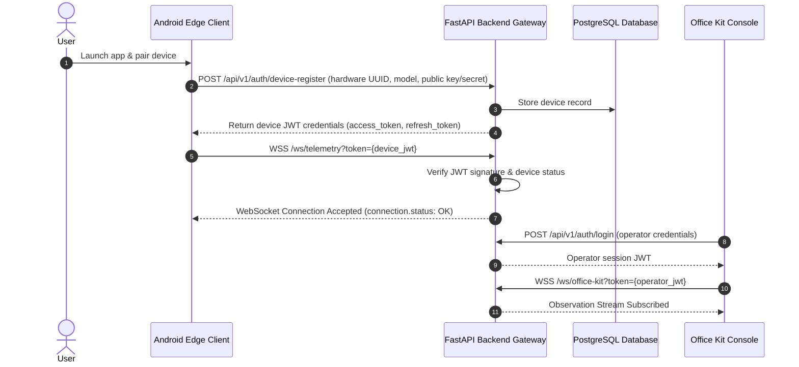

# StreetSense — Security & Privacy Architecture

## 1. Threat Model & Security Posture

StreetSense handles sensitive real-time telemetry from mobile sensors, including precise GPS locations, camera imagery, and device kinetic profiles. The security architecture addresses the following threat vectors:
1. **Unauthorized Device Impersonation**: Attacker spoofing sensor events or false alerts.
2. **Eavesdropping on Telemetry**: Interception of real-time location and video frames in transit.
3. **Sensor Privacy Intrusion**: Unauthorized background camera or microphone eavesdropping.
4. **Data Tampering & Replay Attacks**: Tampering with hazard alerts or replaying old safety triggers.
5. **Denial of Service & Pipeline Starvation**: Flooding WebSocket endpoints with fake high-frequency sensor ticks.

---

## 2. Authentication & Authorization Lifecycle

### Credential Handling & Secret Management
- **No Hardcoded Secrets**: Secrets, keys, and connection strings are strictly injected via environment variables or secure Android Keystore.
- **Short-Lived JWT Tokens**: Device tokens expire in 24 hours with seamless refresh via `/api/v1/auth/refresh`.
- **Operator Role-Based Access Control (RBAC)**:
  - `operator`: Read-only observation of telemetry and alerts.
  - `admin`: Device management, retention policy adjustment, session control.

---

## 3. Privacy-First Edge Design & Permission Governance

1. **Edge-First Processing**: Raw video frames are processed **in volatile RAM** at the edge. They are never continuously streamed or uploaded to the cloud.
2. **Keyframe Storage Policy**: Only frames directly correlated with a confirmed hazard event may be snapshot and transmitted, subjected to explicit user opt-in and auto-pruned after 7 days.
3. **Android Runtime Permissions**:
   - `Manifest.permission.CAMERA`: Requested with prominent in-app disclosure explaining edge-only hazard detection.
   - `Manifest.permission.ACCESS_FINE_LOCATION`: Explicit foreground service permission.
   - `Manifest.permission.RECORD_AUDIO`: **Strictly optional**. StreetSense does not enable or request microphone access unless an explicit acoustic hazard expert is activated by the user.
4. **Foreground Service Transparency**: A persistent Android notification with live status is always displayed while StreetSense is actively sensing, guaranteeing user awareness.
